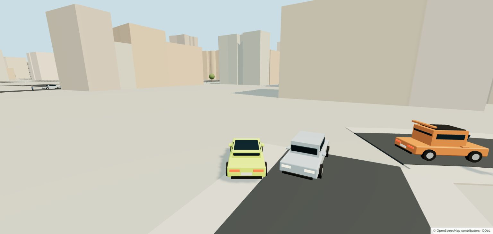

# Streetshift

**Pick a place. Pick a ride.** A small, open-source **3D driving sandbox** with real-world streets, selectable cars and a clear driving view.

**[Play Streetshift](https://itszyless.github.io/streetshift/)** · **[Source](https://github.com/itszyless/streetshift)**



Built with **AI-assisted development** using OpenAI Codex. Independent experiment by [itszyless](https://github.com/itszyless); no affiliation with Rockstar Games, Grand Theft Auto, Google or OpenStreetMap.

## Play

Choose a location and a Coupe, Sedan or Rally, then click **Drive**. The menus disappear while driving. **Escape** opens them again. Only required data attribution remains onscreen.

The included **Vienna, Innere Stadt** neighborhood works immediately without an API key. Its streets and building footprints are real OpenStreetMap data, downloaded on 21 October 2026, with estimated building heights when no height is mapped. It is a simplified 3D reconstruction, not satellite photography.

| Action | Controls |
| --- | --- |
| Accelerate / reverse | W / S or ↑ / ↓ |
| Steer | A / D or ← / → |
| Brake | Space |
| Exit / enter your nearby car | E, while stopped |
| Choose Coupe / Sedan / Rally | 1 / 2 / 3, or menu |
| Reset position | R |
| Open / close menu | Escape |

On touch devices, drag horizontally on the left half to steer; swipe up/down on the right half to accelerate/reverse. Release to coast. Keyboard offers the full controls. The scene pauses when the window loses focus or the page becomes hidden.

## Run locally

Node.js **22.18+ or 24+**:

```sh
npm ci
npm run dev
```

Open the local URL Vite prints. To make a static production build:

```sh
npm test
npm run build
npm run preview
```

Deploy `dist/` on a static host. GitHub Actions tests, builds and publishes GitHub Pages on pushes to `main`. No backend or credentials are needed for the included scene.

## Other real-world locations

Enter a city, street address, or `latitude, longitude`. Location search runs only on explicit submission via Nominatim, with a cooldown and no autocomplete. Coordinates skip geocoding. Nearby roads and buildings load from Overpass, with the OSM map API as a fallback. Network availability, coverage and data completeness vary; errors appear in the menu.

Real-location play is a bounded neighborhood, approximately **1.16 km × 1.16 km**, rather than a seamlessly streamed planet. Included Vienna play is bounded to approximately **760 m × 760 m** within its saved dataset. Reset returns to the spawn. The car spawns on a nearby mapped, drivable street. Some real streets are narrow, pedestrianized or disconnected.

Public OSM services are community infrastructure. See [Nominatim's usage policy](https://operations.osmfoundation.org/policies/nominatim/) and [OSM API usage policy](https://operations.osmfoundation.org/policies/api/). For a high-traffic deployment, replace these endpoints with an appropriately provisioned service. No device geolocation is requested.

## Optional Google photorealistic 3D scenery

The menu contains an **experimental Google Photorealistic 3D Tiles integration**, using NASA's `3d-tiles-renderer` with Google authentication, geospatial reorientation, local Draco decoding, and visible attribution.

1. In your Google Cloud project, enable **Map Tiles API** and billing.
2. Create a browser API key restricted to that API and your actual HTTP referrers.
3. Enter it under **Photorealistic Google 3D scenery**, then click Drive.

The key stays in this page's memory and is sent to Google for tile requests; it is not persisted or committed. Google usage can incur charges. Review [setup and coverage](https://developers.google.com/maps/documentation/tile/3d-tiles), [policies](https://developers.google.com/maps/documentation/tile/policies), and regional/EEA terms before use. Content is streamed for visualization, not scraped or redistributed. Credits for visible tiles remain onscreen.

**This optional integration has not been verified with a billable key.** It needs provider-backed testing for tile availability, terrain alignment, road-level quality and performance. Scene/terrain detail differs by location. The default OSM reconstruction remains the verified path. A Google key alone will not produce the quality of a modern AAA driving game.

## Scope and visual expectations

This is a **playable prototype**, not GTA, a digital twin, or the photorealistic concept shown in `docs/design-concept.png`. That image is **AI-generated concept art**, not a screenshot or a promised rendering result. The screenshot above shows the actual build. Default visuals use simple 3D mesh geometry, estimated heights, generic vehicles, repeated windows and simulated characters.

Traffic and pedestrians are **fictional simulation agents**. They are not live real-world people, live vehicle tracking or licensed branded car models. Traffic moves back and forth along individual mapped road segments, without intersection routing or traffic lights. You can enter your own car; traffic cars cannot be taken over. The three car types have different acceleration, top speed and handling.

Simulation includes acceleration, reverse, steering, braking, building-footprint collisions, traffic contact slowdown, walking, camera following and collision avoidance. It runs at a fixed 120 Hz physics step, with capped catch-up, rendering on animation frames and a throttled React status update. Building queries use a spatial grid; district meshes are batched and windows/trees instanced. Device pixel ratio is capped. Frame rate depends on the device; **zero latency is not promised**.

The reconstructed world is flat. Missing buildings, rivers, terrain, bridges, tunnels and obstacles visible only in photographs are not inferred. No interiors, multiplayer, combat, connected road navigation or AAA assets are included. Google-mode terrain alignment remains experimental. For additional realism, this foundation needs better vehicle/character assets, road-graph traffic, terrain-aware physics and substantial art/performance work.

## Architecture

- `world.ts`: OSM parsing, geocoding, neighborhood loading, geographic conversion and indexed collision queries.
- `physics.ts`: deterministic car movement.
- `engine.ts`: mutable simulation state, input state, traffic and pedestrian motion.
- `view3d.ts`: Three.js scene, mesh generation, chase camera, resource lifecycle and optional Google tiles adapter.
- `vehicles.ts`: selectable vehicle specs.
- React: entry/pause menu; no driving HUD.

See [CONTRIBUTING.md](CONTRIBUTING.md), [CREDITS.md](CREDITS.md), and [docs/QA.md](docs/QA.md).

## About

Streetshift is an experiment by **itszyless** in turning a real neighborhood into a tiny driving playground. Designed to be understandable, hackable and fun to extend. Development, documentation, UI exploration and original geometry were created with AI assistance.

## License

Code: [MIT](LICENSE). Included OSM dataset: **ODbL**, with separate attribution/license in [public/data/README.md](public/data/README.md). Google content remains subject to Google's terms. Draco decoder files retain their Apache 2.0 license. Third-party map content is not relicensed by this project.
